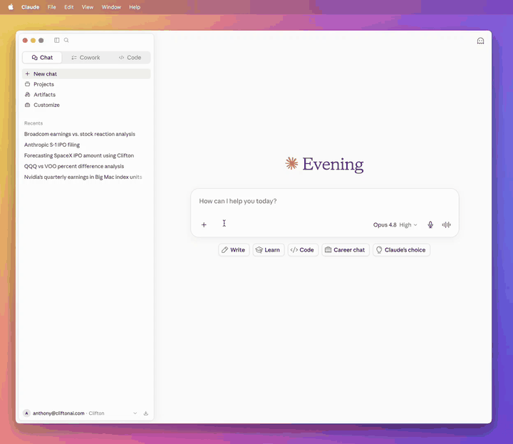

#  Clifton MCP

[](https://github.com/cliftonai/clifton-mcp/actions/workflows/ci.yml)
[](CHANGELOG.md)
[](LICENSE)
[](https://github.com/cliftonai/clifton-mcp/pulls)

Clifton exposes MCP tools for markets and finance research, raw structured data and document retrieval, and Data Vault file discovery and downloads. `clifton_ask` answers questions about public companies, ETFs, crypto, bonds, options, and macro data from SEC filings, earnings transcripts, analyst expectations, market data, news, and attached Clifton Data Vault files, then cites the documents or data it used.




**Endpoint:** `https://ai.cliftonapi.com/v2/mcp`

## Upgrading from v1

MCP v2 is live and `/v1/mcp` is retired. The old endpoint now only returns an upgrade notice; it runs no tools.

- **Manual connections:** change the URL from `/v1/mcp` to `/v2/mcp`, reconnect, and refresh the tool list.
- **Claude Code plugin:** update `clifton-mcp` to 0.2.0, then restart Claude Code or reconnect with `/mcp`.
- Do not add a second Clifton connection. Agent tools are gone in v2; existing agents and reports remain in the [Clifton console](https://console.cliftonapi.com).

[Release notes](CHANGELOG.md#020---2026-11-19).

## How answers work

`clifton_ask` acknowledges a saved research request before its answer is ready. Your app waits `poll_after_seconds` (currently ten seconds), then uses `clifton_get_response` to read the current saved state. Each read returns as soon as storage completes; while running, your app waits again before its next read. This requires the app's own timing facility; hosts without one remain unvalidated for this flow. [Protocol details](API.md).

`model` defaults to `instant`. Production currently serves Instant only; Deep Thinking will appear in `tools/list` when it is enabled for MCP. `effort` selects `extra_low`, `low`, `medium` (the default), `high`, or `extra_high`. MCP does not offer `ultra`. Saved responses report both choices; resuming the same message requires that saved pair and the returned IDs. [Model, effort, and continuation details](API.md#clifton_ask-starts-one-answer).

## Connect

### Claude Desktop, Claude Web, ChatGPT Web

Add a custom connector in Claude Desktop or Web. Use ChatGPT Web's custom-plugin setup where your account permits it; ChatGPT Desktop has not been verified. Use this server URL:

```text
https://ai.cliftonapi.com/v2/mcp
```

Sign in with your Clifton account. ChatGPT Web requires an eligible account and workspace permission. These are supported setups, but they have not been separately acceptance-tested on v2; Claude Code over OAuth has been tested end to end.

**Step-by-step setup for each host →** [INSTALL.md](INSTALL.md)

### Claude Code Plugin

```
/plugin marketplace add cliftonai/clifton-mcp
/plugin install clifton-mcp@clifton-mcp
```

On first use, Claude Code connects to Clifton over OAuth. No Client ID is required. Then ask:

> What was NVDA's most recent reported quarterly revenue?

The plugin adds a [`clifton-research` skill](plugins/clifton-mcp/skills/clifton-research/SKILL.md) that covers asking and polling, direct data, and Vault downloads.

### Cursor, Codex, Manual Claude Code

Use an API key from [console.cliftonapi.com](https://console.cliftonapi.com) and pass it as:

```text
X-API-Key: <your-api-key>
```

Config snippets live in [`examples/`](examples/).

## Tools

- **`clifton_ask`** — starts a saved markets or finance request and returns its session/message IDs.
- **`clifton_get_response`** — reads the current saved state for those exact IDs, with the answer and citations when complete. Stop polling on completion or when action is required.
- **`clifton_search`** — explicit raw structured-data queries through the public search API.
- **`clifton_retrieve`** — explicit ranked document retrieval through the public retrieve API.
- **`clifton_list_vault_files`** — finds authorized Clifton Data Vault files. Use returned file IDs to download a file or pass them to `clifton_ask.attachments` for analysis.
- **`clifton_get_vault_file`** — returns an authorized signed S3 download URL for one file ID, valid for up to 15 minutes.

MCP v2 does not expose agent tools. Manage recurring agents and reports in the [Clifton console](https://console.cliftonapi.com). [Agent-tool availability](AGENT-TOOLS.md).

Full tool reference, auth, and errors: [API.md](API.md).

For the two direct-data tools, discover the contract at runtime: call with
`{"request_json":"{}"}` for public scopes, then with a returned scope in the
JSON string for request schemas, and build the query from that response.
Scopes and schemas come from the endpoint; MCP does not copy their catalog.
The selected tool's `request_json` instructions explain its request envelope.
These tools require an eligible organization account. General analysis and
sourced research still use `clifton_ask`. Direct-data delivery is bounded at
45 seconds and 1 MiB for the complete encoded response. Use native pagination
where supported or a narrower request, and never automatically repeat an
unknown outcome. [Direct data reference](API.md#direct-public-data).

## Get an account

Sign up at [console.cliftonapi.com](https://console.cliftonapi.com) for an API key and trial. Learn more at [cliftonai.com](https://cliftonai.com).

## Docs

- [INSTALL.md](INSTALL.md) — per-host setup
- [API.md](API.md) — endpoint, auth, tools, errors
- [TROUBLESHOOTING.md](TROUBLESHOOTING.md) — common connection/OAuth/tool issues
- [SUPPORT.md](SUPPORT.md) — how to get help
- [SECURITY.md](SECURITY.md) — vulnerability reporting
- [CHANGELOG.md](CHANGELOG.md) — changes to the tool surface

## Legal

[Privacy Policy](https://cliftonai.com/#/privacy) · [Terms of Service](https://cliftonai.com/#/terms)
